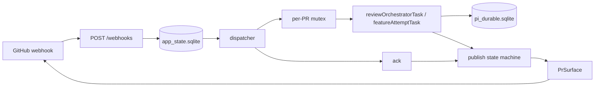

# Topology

## How it works

PR Agent is one Node 24 process. It serves `POST /webhooks`, `GET /health`, and
`GET /ready`, runs the dispatcher and every agent session, publishes to GitHub
through `PrSurface`, and runs retention. There is no second role and no external
queue or database.

Storage splits by responsibility, both files under `SQLITE_DIR`:

- `app_state.sqlite` (`node:sqlite`, `src/state/`) owns every long-lived
  coordination fact: webhook dedupe, PR lifecycle and lane epochs, `work_runs`
  and `work_run_attempts`, `publish_intents` and `publish_records`, `/ask`
  quotas and receipts, head CI state, repository capabilities, rate-limit
  circuits, and `agent_feedback`. The schema is 15 tables created at open
  (`src/state/schema.ts`, `PRAGMA user_version = 1`).
- `pi_durable.sqlite` (`@earendil-works/pi-durable@1.6.0`,
  `src/agent/runtime/durable/`) owns only agent conversations and durable
  tasks: the `reviewOrchestratorTask` with its four task-owned specialist
  conversations, and the `featureAttemptTask` for the other model-backed kinds.

Both open with `PRAGMA synchronous = FULL` and refuse to start unless the
read-back is `2`. `pr-agent.lock.sqlite` holds `BEGIN EXCLUSIVE` for the
process lifetime, so a second process on the same `SQLITE_DIR` fails fast and a
`SIGKILL` releases the lock with the process.

Intake verifies the signature, parses the payload with `toIntakeCommand`, and
does any slow lookups (bot identity, slash authorization) first. It then runs
one `BEGIN IMMEDIATE` transaction on `app_state.sqlite` (`src/state/intake.ts`):
delivery-key and body-hash dedupe, `/ask` scoped trigger-comment identity and
quota admission, approval gating, the `pr_state` lifecycle update, and new
`work_runs` rows with `status = 'pending_dispatch'`. It returns `200` only after
`COMMIT` and `503` on any failure, so GitHub redelivers. `node:sqlite` is
synchronous; nothing awaits inside the transaction.

A missing or invalid signature returns `401` before any intake state is
written.

A missing delivery ID falls back to the body hash. A cross-delivery body replay
deletes the new delivery reservation. Every duplicate arrival inserts its own
`webhook_rejections` row with its incoming delivery ID, body fingerprint, and
guard reason, with no new work. Evidence expires by its own arrival age using
`WEBHOOK_EVENTS_RETENTION_SECONDS`. These patterns do not prove malicious intent.

PR lifecycle lives in `pr_state`. `merged` is absorbing, a newer provider
`observed_at` wins, and equal timestamps resolve `merged > closed > open`. Known
closed or merged PRs cannot create review work or transfer progress ownership;
slash commands receive an explanatory reply. Only a newer reopen restores
admission, without automatically starting a review. Automatic and slash review
share one active review slot per PR. `/review force` cancels and replaces in
intake order, and a `synchronize` push preserves an active slash review.
Slash work and verification from a maintainer reply use the current lane epoch
in the same intake transaction, creating `pr_state` when it is absent.

Approval mode decides trust on open. Trusted authors enter automatic review;
untrusted forks record one awaiting approval in `pr_state` and get one
acknowledgement notice. A matching PR workflow start consumes it except when
`workflow_start_admits` is false. An authorized approving PR review or slash
review consumes it once. Close or merge withdraws it. Details:
[review approvals](agent-work-ops.md#review-approvals).

The dispatcher (`src/agent/runtime/durable/dispatcher.ts`) is one in-process
loop, woken by intake commits and a timer. It claims a due `pending_dispatch`
row, or a `retry_scheduled` row whose `next_retry_at` has passed, increments
`current_attempt_no`, inserts `work_run_attempts(work_id, attempt_no,
attempt_id, status = 'starting')` with a fresh `attempt_id`, and checks
cancellation and the lane epoch. `src/state/workRuns.ts` is the only module
that writes `work_runs.status`. Per-kind concurrency comes from the
`*_CONCURRENCY` settings. A keyed in-process mutex (`src/state/prMutex.ts`)
serializes `review`, `description`, `triage`, and `verification` execution per
PR, plus the read-decide-write publish sequences that thread mutations and the
verification verdict share.

Work kinds:

- `review` runs as `reviewOrchestratorTask` (below).
- `ask`, `description`, `triage`, `verification`, and `ci_projection` run as
  `featureAttemptTask`: one `run` phase that executes the feature body through
  `createFeaturePiSession`. It is not replay-safe. After a crash, boot aborts
  it and the attempt becomes `retry_scheduled` with `attempt_no + 1`, or
  cancelled or superseded if it is no longer current.
- `ack` runs directly in the dispatcher, without a Pi task, and still writes
  `work_runs` and `work_run_attempts`.
- `ci_projection` is scheduled by a debounced timer from
  `pr_head_ci_state.next_projection_at`. It edits the existing progress comment
  after a revision recheck.

An attempt starts with one atomic Pi commit that creates the ownerless root
conversation and the durable task, stamping `(workId, attemptNo, attemptId)`
into the task input and a root-conversation doc. `markRunning` then records the
conversation and task IDs. If it updates no row because the work run was
cancelled or superseded meanwhile, the conversation is aborted at once. The
task's terminal handler writes the outcome into `app_state.sqlite` directly; it
never relies on `afterRun`.

`reviewOrchestratorTask` runs the phases `recon`, `dispatch_specialists`,
`wait_specialists`, `synthesize_and_validate`, and `publish`. Every phase entry
checks that the work run is still active and owns the current lane epoch, and
ends the task as cancelled otherwise. The orchestrator's own turns run in a
task-owned `orchestrator` child conversation. The four specialists
(`correctness`, `security`, `quality`, `tests`) are task-owned child
conversations whose provider session ID is the shared 35-character prompt cache
key, so aborting the root conversation cascades to all of them. Specialist 0 is
submitted first; the other three follow its first settled response or 5 s.
Child creation and each submission are separate Pi transactions, and every
submission uses the deterministic request ID `${attemptId}:${role}:${turnNo}`,
so a restart finds the same submissions instead of resending. The task
checkpoint holds the brief, the recon pack and its hash, each specialist's
outcome (`complete`, `partial`, or `failed`) and report, the accepted-findings
ledger, and publish progress. `synthesize_and_validate` reads settled specialist
history and validates every finding against the evidence the model was actually
shown. Repository-scoped preflight gates new review work, exact head-bound
receipts recover before admission, and `reviewVerdict(...).close` selects
immutable check and status output. See
[review reliability](operations.md#review-reliability-rollout).

Lifecycle claims and watchdog hops do not spend work retries. Close, reopen,
cancel, and supersede only mark rows, and boot reconciliation adopts or aborts
the recorded attempt without charging a new one. Only a dispatcher claim
inserts a new `work_run_attempts` row. Each work run admits at most
`QUEUE_RETRY_LIMIT + 1` attempts, with `retry_scheduled` backoff from
`QUEUE_RETRY_DELAY_SECONDS` up to `QUEUE_RETRY_DELAY_MAX_SECONDS`. A started
attempt counts even when it is interrupted before the provider.

## Publishing

Every GitHub mutation runs through `publishOnce` in `src/state/publish.ts`, a
fail-closed state machine on `publish_intents`:
`reserved → mutating → reconciled | mutation_failed |
outcome_unknown_recoverable | outcome_unknown_terminal`.

The `reserved → mutating` transition commits in one `BEGIN IMMEDIATE` only when
the work run is `running` (cancellation notices and verdict cleanup excepted),
it owns the active lane epoch in `pr_state`, shutdown has not been requested,
and no `mutating` or overwrite-blocking `outcome_unknown_recoverable` intent
exists on the same `(pr_key, resource_target)`. Each intent is exactly one HTTP
call; `ack` gets one intent per delete-reaction and add-reaction call.

Mutations use a dedicated Octokit client (`src/github/mutationOctokit.ts`) with
no retry or throttling plugin and `AbortSignal.timeout(20_000)` on every write.
Reads keep the retrying, throttled client. The triage push stays bounded by
`LOCAL_WORKSPACE_FETCH_TIMEOUT_MS`.

- Success commits `reconciled` plus a `publish_records` row under both the
  shared key and the work-run key, and stores the first selected review verdict
  in `pr_state.selected_verdict_json`. Before `publishOnce` reconciles a result,
  including one found by lookup, it rechecks the run status and lane epoch in
  the same transaction. A stale result ends as `outcome_unknown_terminal`
  without a publish record or another send. The fence cannot undo an HTTP
  write GitHub already accepted. Shutdown still lets current writes settle.
- A provider-proven rejection (`isKnownNoAcceptanceMutationError`, or a
  per-call override) becomes `mutation_failed`, which a fresh attempt may
  retry.
- Any other failure runs inline exact-evidence recovery with at most three
  backoff lookups, releasing the in-memory mutex between sleeps while the
  `mutating` row keeps the SQLite fence. Unresolved outcomes become
  `outcome_unknown_recoverable` (lookup-only, swept at boot and periodically)
  or `outcome_unknown_terminal` (fail closed, never remutated).
- `reconciled` returns the cached result; `mutating` only reconciles. Labels
  and the review commit status fail closed.

With no local `publish_records` entry, the standing review, summary comment,
and CI progress comment paths first look for existing bot artifacts carrying
`operation-intent` markers (`src/github/recoverPrSurfaceMutation.ts`) and
hydrate `publish_records`, so a fresh data volume never duplicates them on open
PRs.

Verification checks cancellation, supersession, and bound/live head equality
before its empty-inventory completion and at the late non-empty publish gate.
Stale empty work completes degraded without clearing a verification failure
signal. Non-degraded verification refreshes a changed standing app review from
fresh finding state. An open same-id copy at or above the check threshold is a
blocker even when the oldest thread for that id is resolved or below the
threshold. Its inventory read and publication share the PR mutex with
full-review terminal publication, so a starting full review cannot publish its
verdict first and then be overwritten.

Progress publish records stay owner-gated. A replacement review owns the
progress comment; late ticks from an earlier run are skipped or rejected with
an ownership warning, and neither path reassigns the replacement's record.

`check_run` and `status` facts commit with intake and set
`pr_head_ci_state.next_projection_at`. PR open, head change, and completed
workflow events schedule the same projection; ack, ticks, and publish schedule
it after comment writes when a seed or newer revision is needed. Projection
joins shared facts with installation-scoped source access; unknown sources have
bounded retries, denied sources do not poll, and restored sources need a fresh
complete listing.

## Boot, shutdown, and reset

Boot is a strict two-phase barrier (`src/agent/runtime/durable/boot.ts`).
Phase A runs with the harness paused and Pi strictly read-only:

1. Reconcile every `mutating` publish intent and sweep
   `outcome_unknown_recoverable` ones.
2. Read Pi state through `harness.inspect()` and `harness.commit(tx =>
tx.scanTasks(...))` / `tx.submissionByRequest(...)` to project terminal
   outcomes into `work_run_attempts` and `work_runs`, adopt orphan tasks by
   `(workId, attemptNo)` whose attempt never recorded its task, and collect
   cancelled or superseded tasks to abort.
3. Load pending CI projections into the timer queue without firing them.

Phase B calls `harness.resume()`, aborts the collected conversations, and
registers resumed reviews with the dispatcher before it starts claiming work.
Each resumed review holds a review slot and its PR execution mutex until the
task settles. Boot starts CI timers and retention before opening `/webhooks`.
Nothing calls `submit`, `abort`, `waitForTask`, `waitForIdle`, or `compact`
before `resume()`, because each of those turns scheduling on. An unexpected
`harness.closed` exits the process non-zero.

On `SIGTERM` or `SIGINT`, `/webhooks` returns `503` and `shutdownRequested`
blocks new `reserved → mutating` transitions. The dispatcher and timers pause,
in-flight writes get up to `SHUTDOWN_GRACE_MS` (default 25 000) to settle, then
the harness closes, followed by `app_state.sqlite` and the lock. Compose
`stop_grace_period` stays at least 5 s above that budget, and deploys stop the
old container before the new one starts.

`src/agent/runtime/durable/durableReset.ts` checks `pi_durable.sqlite` on a
timer and at boot. Past `PI_DURABLE_RESET_MAX_BYTES` or
`PI_DURABLE_RESET_MAX_AGE_SECONDS`, `/webhooks` stays open and keeps answering
`200` with new rows as `pending_dispatch`. Every harness user is quiesced. The
reset proceeds only with no `running` or `starting` attempts, no `mutating`
intents, and no live tasks or unsettled submissions in `harness.inspect()`. It
closes the harness, moves `pi_durable.sqlite`, `-wal`, and `-shm` together into
`${SQLITE_DIR}/archive/<timestamp>/`, reopens a fresh harness, resumes it, and
restarts the dispatcher and timers. Runbook:
[the pi_durable reset](agent-work-ops.md#pi_durable-reset).

`src/state/retention.ts` runs the daily cleanup on `app_state.sqlite`, then
`PRAGMA wal_checkpoint(TRUNCATE)`. See
[retention](agent-work-ops.md#retention).
