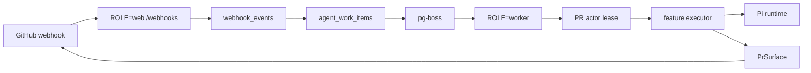

# Topology

## How it works

Lifecycle claims and watchdog hops do not spend work retries. Executors admit
fresh work through the runner's memoized `beginAttempt`, backed by a short
lease-first transaction in `workItemStateRepository.ts`. Actual resumed work
still charges; recovery-only completion remains possible at the cap.

Web verifies/parses signed GitHub webhooks and commits deduplication, `agent_work_items`, and pg-boss jobs in Postgres. Pure `toIntakeCommand` requires bot identity or requests authentication. Scheduler submits to `runDelivery`, which owns transactions and post-commit events. `DeliveryTx.withReviewIntake` owns the review lock and separate retained lifecycle read; insertion finalizes event decisions. Automatic/slash review intake shares a per-PR transaction lock: concurrent `/review force` requests cancel/replace in intake order. Queued/running leased cores seed recovery before atomic PR actor lease acquire-and-claim. Completed/failed deliveries finish without seeding or acquiring. Stale active snapshots leave copies that drain. Upgrade all workers together; rollback restores loops. Keep work, leases, intents, and publish records ([runbook](agent-work-ops.md#terminal-watchdog-deliveries)). Publication uses `PrSurface`; lease epochs fence writes.

Close and reopen also hold the review intake lock. Accepted lifecycle observations
write `pr_review_lifecycle` in the same transaction as cancellation or admission.
Automated and slash review intake read that predicate in a separate statement
after acquiring the lock. Known closed or merged PRs cannot create intake review
work or transfer progress ownership; slash commands receive an explanatory reply.
Only a newer provider-observed reopen restores admission, without automatically
starting a review. Terminal state wins timestamp ties; merged never reopens.
The marker outlives webhook/work retention. Worker-side stale-head replacement
insertion takes the same intake lock and reads lifecycle in a subsequent statement,
before locking the parent lease and item. Closed/merged refusal cannot transfer
progress ownership; close sees any replacement committed before it acquires the lock.

Approval mode decides trust on open. Trusted authors enter automatic review;
untrusted forks insert one `pr_review_approvals` awaiting row and acknowledgement
notice. Synchronize moves its head under the review intake lock. A matching PR
workflow start consumes the awaiting row except when `workflow_start_admits` is
false. An authorized approving PR review or slash review consumes the awaiting
row once. Close/merge withdraws it. Delayed notices reread state under
the progress-publication lock before writing. Details:
[ADR 0042](adr/0042-review-approval-mode.md) and
[review approvals](agent-work-ops.md#review-approvals).

Duplicates commit metadata-only `webhook_delivery_duplicates` rows in the intake transaction, with no new work or jobs. Each rejected arrival records its incoming delivery ID, body fingerprint, and guard reason. Evidence expires by its own arrival age using `WEBHOOK_EVENTS_RETENTION_SECONDS`, independently of accepted events and replay reservations. These patterns do not prove malicious intent.

Interrupted mutation recovery requires exact evidence. Missing usable results
stop terminally with `outcome_unknown`; failed/incomplete reads stay transient.
Validated review artifacts are stored for a review that binds a base sha. They are not transcripts or evidence authority.
See [ADR 0044](adr/0044-review-validated-artifact-recovery.md) for recovery,
child-only denial receipts, independent audit/analytics, and committed terminals.

Leased execution surfaces reread durable cancellation at entry and immediately
before each mutation callback, then reassert lease ownership. Visible cancellation
blocks feature output even before the observer aborts the signal. Terminal notices
and verdict cleanup retain their existing signal and epoch fences. A request
already in flight cannot be withdrawn.

Stale-head replacement retries merge incoming defaults with the stored child
payload in the conflict statement. Stored values win collisions, including across
lease epochs, so retry cannot erase another writer's changes. A new replacement
still receives the complete original source and slash-command context.

Review's terminal hook cancels a pending stale-head replacement even when its
claim wins concurrently or a delivery races the abort. Queue existence cannot veto
the state-predicated cancellation write. Successful in-attempt enqueue and the
terminal fallback's persisted enqueued marker remain exempt. Leftover deliveries
for cancelled work cannot publish feature output. After a queued miss, cancellation fixes the replacement's
recorded epoch and locks its lease before updating the item. It never follows a
newer epoch or clears a holder. Unconfirmed cancellation emits
`agent_work_replacement_cancel_failed` at error level and rejects.

Review runs recon, correctness/security/quality/tests specialists, judgment, and
publication. Repository-scoped preflight gates new work; exact head-bound receipts
recover before admission. `reviewVerdict(...).close` selects immutable check/status
output with independent applicability and repair. See
[review reliability](operations.md#review-reliability-rollout).

`check_run` and `status` facts commit with intake. PR-open/head-change and completed
workflow events request `ci-projection`; ack, ticks, and publish request it after
comment writes when a seed or newer revision is needed. `requestHeadCiProjection`
owns enqueue. Projection joins shared facts with installation-scoped source access;
unknown sources have bounded retries, denied sources do not poll, and restored
sources need a fresh complete listing. Verification signal transitions share the
head revision and enqueue transaction. See
[ADR 0035](adr/0035-head-ci-state-projection.md).

Ask work is deliberately unleased and relies on publish-record idempotency. Canonical ask intake resolves the triggering mention — installation, PR resource, comment surface, and comment ID — under a transaction-scoped advisory lock before quota admission, so repeated accepted deliveries of one mention quietly join its retained work item in any status instead of creating a sibling; the agreement ends when retention deletes the item. Triage may push a branch and uses separate publish records for thread actions.

A slash `/review`, `/describe`, `/triage`, or `/verify` that reaches insertion
resolves active work in one value-preserving UPSERT. Its conflict row stays
locked through intake commit, including triage's ID-pinned payload read.
Cancellation or completion that finishes first allows a fresh item; otherwise
intake commits the normal in-progress acknowledgement before that transition.
`/verify` also has an unchanged, nonlocking active-work precheck.
These row locks are separate from review advisory ordering and execution leases.

Concurrent own-verdict closes select the first output by CAS on the existing
per-work-item check row. A verdict-only session try-lock spans check/status
application, with autocommitted SQL and separate acceptance receipts. Pool
admission retains a connection for leased surface queries; unsafe unlock
destroys the client. Repair uses saved selection and exact child acceptance, never guessed success
from check creation. Unknown intents stay fail-closed. Upgrade affected workers
together and preserve selections/intents on rollback
([recovery](agent-work-ops.md#own-verdict-recovery)).

Verification checks cancellation/supersession and bound/live head equality before its empty-inventory completion, as well as at the existing late non-empty publish gate. Stale empty work completes degraded without clearing a verification failure signal.

CI projection intake retains accepted delivery/event pairs in the job's
`correlations` array, including when debounce absorbs a delivery. That metadata
commits in the intake transaction; a missing target or failed attribution write
rolls back intake. The original top-level correlation remains the worker log
identity. Projection still renders from head state. Inspection and retention:
[the queue runbook](agent-work-ops.md#ci-projection-delivery-attribution).

Worker shutdown is ordered and bounded. Intake closes first, pg-boss drains on
`SHUTDOWN_DRAIN_TIMEOUT_SECONDS`, all in-flight queue handlers settle for
`SHUTDOWN_SETTLE_TIMEOUT_MS`, and the five durable work queues then get one more
`SHUTDOWN_SETTLE_TIMEOUT_MS` window, concurrent with the bounded analytics
flush, before the Postgres pool ends. A dispatch still running at that cutoff
logs `agent_worker_shutdown_incomplete`; the cutoff ends the wait, not the
dispatch, so its late terminal write fails against the ended pool. A later
worker recovers the row through the existing watchdog chain or lost-running
sweep.

Lost-running diagnostics are advisory. The sweeper locks the lease key and
excludes job writes before a fresh READ COMMITTED failure statement. A missing
lease key takes a table lock against first acquisition. Lock contention or a
protected-query timeout leaves the item unchanged for a later pass. Query and
idle-in-transaction limits are local to that transaction (1,000 ms each).
Only a committed mark permits a candidate's crashed verdict close; revived work
stays running. Terminal reviews with open checks still have a separate repair lane.

Progress publish records remain owner-gated independently of the actor lease.
A zero-row progress write rechecks the lease, then warns and raises
`agent_work.progress_comment_ownership_conflict` if the lease still holds or
the writer is unleased. Preflight foreign-owner ticks above revision zero warn
and skip. Neither path reassigns the replacement's progress record.

`src/db/sessionLock.ts` owns shared progress/verdict/thread half-pool admission,
typed `SessionLockKey` encoding, session try-locks, bounded progress waits,
and safe unlock/release precedence. Callers cannot supply admission capacity.
`src/agentWork/fencedWrite.ts` owns numeric-epoch precheck/write/zero-row
recheck sequencing; each repository retains its exact SQL predicates and
its existing choice of checks.

Revisioned progress and summary upserts serialize the fresh comment read,
claim, GitHub write, and result record under one resource/lens advisory lock.
Claims stay autocommitted. Contenders release clients before bounded backoff;
per-pool admission leaves at least half the connections for nested mutation
checks and unrelated database work. A slow GitHub call retains its holder's
client. CI projection and direct comment edits do not share this lock.
